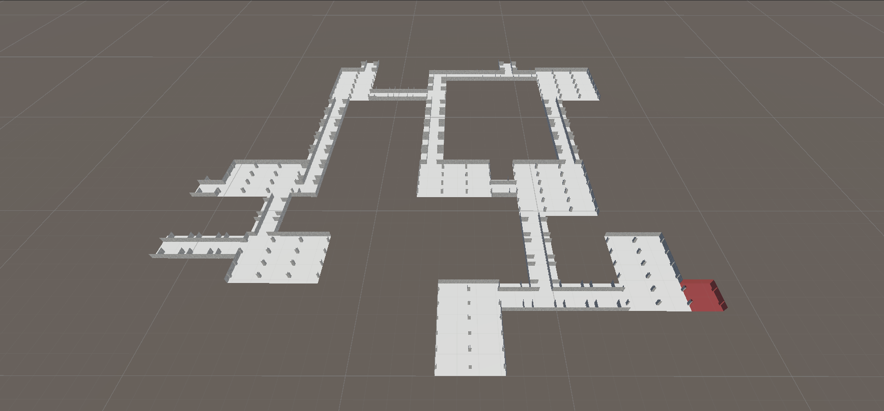
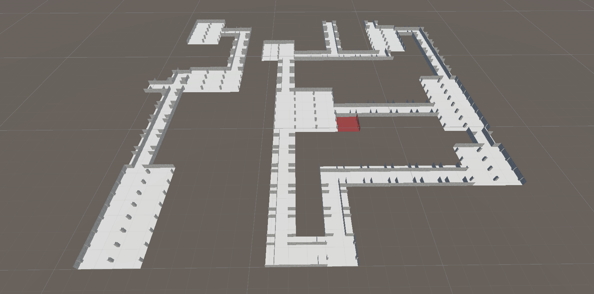

# BSPダンジョン自動生成システム

## 開発について

本プロジェクトは、コードの改善案の検討やエラー解析、アルゴリズムの比較などに生成AIを活用しましたが、実装内容の理解・設計・動作検証はすべて自身で行い、必要に応じてコードの修正・再設計を行っています。

## プロジェクトの概要

本スクリプトは、Unity上でBinary Space Partitioning(BSP)法を用いてダンジョンを任意のサイズで生成するシステムです。プレイヤーとして指定したオブジェクト(本プロジェクトではMainCamera)の現在位置を基準に、一定サイズの「チャンク」単位でマップデータを遅延生成し、必要な範囲のみを動的に配置・破棄することでメモリと処理負荷を抑えています。また、入口として想定されるセルは常に参照できるように範囲外での削除をしていません。

マップ生成は、座標とシード値から一意な乱数を得られるハッシュ関数をもとに完全決定論的に行われ、同じシードであれば常に同じマップが再現されます。各チャンクはBSPアルゴリズムで再帰的に空間分割され、分割された領域ごとに部屋を配置し、木構造を辿って全ての部屋を通路で接続します。

## 実行方法

1. Unity 6.2でプロジェクトを開く
2. Assets\Scenes\SampleSceneを開く
3. Playを押す
4. SceneビューでMainCameraを任意の場所へ移動

## 構成スクリプト

### メインスクリプト
- **BSPMapGenerator**: BSP法を用いたマップ生成スクリプト
#### インスペクターで設定できる項目の簡単な説明
- **player**
  - ここで指定したオブジェクトを中心にマップを生成する

- **roomPrefabs / corridorPrefabs**
  - 配置する部屋・通路を登録します。

- **chunkBiomeTypes**
  - チャンクごとに使用する部屋・通路の種類を指定できる。特に指定しなければすべての種類から設置する部屋や通路を選択する

- **inputSeed**
  - 同じシード値で同一のマップを再現できる

### `BSPMapGenerator`の`baseobject`に必要なコンポーネント
- **Room を継承したスクリプト**: 部屋の種類ごとに、向きの変更や不要な壁の削除処理を行う

### その他スクリプト
- **MeshCombiner(static)**: メッシュ統合を行う
- **ChooseForChunce(static)**: リストの中から確率に応じて選択肢を返す
- **UVChanger(static)**: オブジェクトのUVを書き換える

## 工夫点

- シード値による再現性のあるマップ生成
- チャンク単位で生成・破棄することでメモリ使用量を削減
- コルーチンによるフレーム分散で生成時の負荷を軽減
- メッシュ結合により描画負荷を削減
- メインスレッドとワーカースレッドで処理を分割することで処理を分散